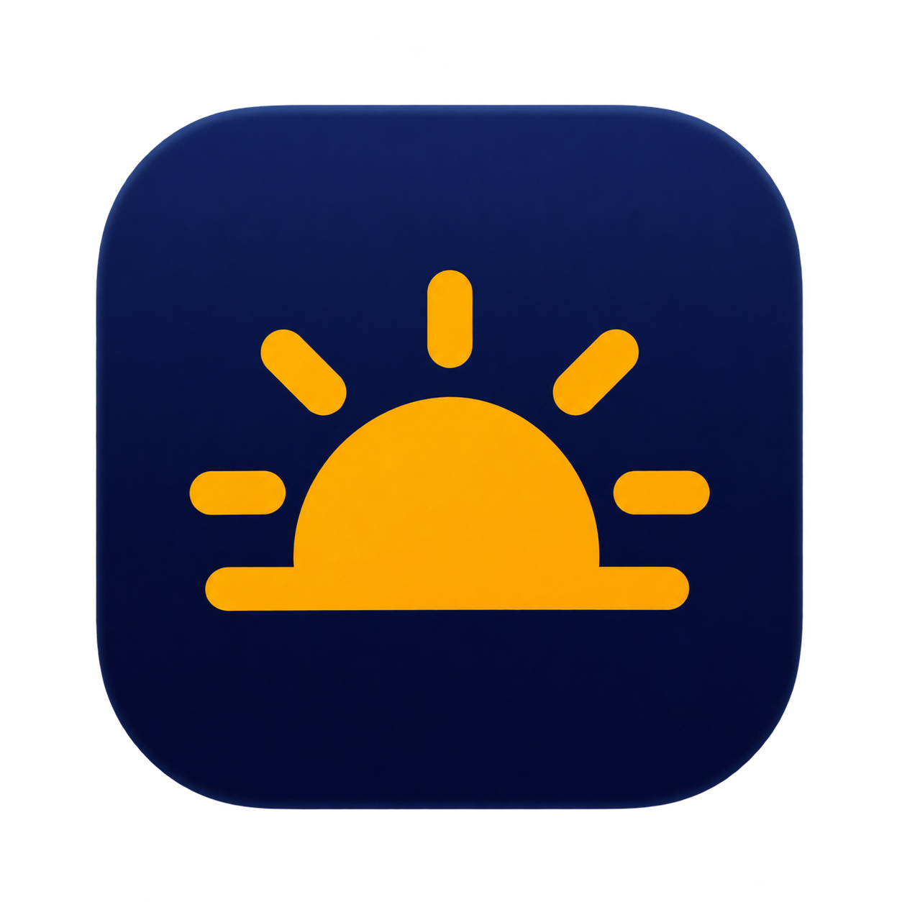

<p align="center">
  
</p>
<h1 align="center">Sunbar</h1>
<p align="center">XDR brightness for your MacBook Pro.</p>
<p align="center">
  <a href="https://github.com/othmanehousni/Sunbar/actions/workflows/build.yml"></a>
</p>

Sunbar is a small macOS menu bar app that extends the brightness of the built-in Liquid Retina XDR display. Native HDR keeps the boost across apps, Mission Control, full-screen windows, and desktop swipes through a single compositor filter.

[Download](https://github.com/othmanehousni/Sunbar/releases) · [Build from source](#build-from-source) · [Report an issue](https://github.com/othmanehousni/Sunbar/issues/new?template=bug_report.yml)

## Install

1. Download the Sunbar ZIP from Releases and extract it.
2. Move **Sunbar.app** into **Applications** and open it.
3. Open the sun icon in the menu bar and turn on **XDR Brightness**.
4. Adjust the boost slider. **Open at Login** starts Sunbar automatically.

Beta builds are ad-hoc signed. macOS may require approval in **System Settings → Privacy & Security → Open Anyway** after the first launch attempt. Building from source is also supported. Developer ID signing and notarization are documented in the release guide. [Release guide](docs/RELEASING.md)

## Compatibility

| | |
| --- | --- |
| Display | Built-in Liquid Retina XDR on a 14-inch or 16-inch Apple silicon MacBook Pro |
| Build target | macOS 14 or later, arm64 |
| Toolchain | Swift 6 with Xcode 16 or newer, or compatible Command Line Tools |
| Verified hardware | MacBookPro18,3 on macOS 27.2 |

Use the **Apple XDR Display** preset under **System Settings → Displays**. Available boost depends on the panel's live EDR headroom and macOS display limits.

Native HDR uses private Core Animation and SkyLight interfaces, checked at startup. Compatibility with other macOS versions needs hardware testing. Increased display brightness uses more power.

## Build from source

```sh
git clone https://github.com/othmanehousni/Sunbar.git
cd Sunbar
./build.sh --test
./build.sh
open build/Sunbar.app
```

The build uses the macOS toolchain and generates the app icon from the included artwork. Move the built app into Applications before enabling its login item.

Create a ZIP and SHA-256 checksum with the release script.

```sh
./release.sh
```

## How it works

A floating-point backdrop filter applies calibrated brightness gain inside WindowServer. A small HDR trigger keeps the display in EDR. Brightness follows the system's live compositor updates, including Mission Control and Space transitions.

All brightness processing happens locally. Sunbar uses the native compositor without screen capture, accounts, analytics, or network requests. It pauses the boost during sleep, inactive sessions, and system authorization UI.

The app uses one compositor filter and a one-pixel HDR trigger. It updates the filter only when the gain changes. Release builds enable the hardened runtime without exception entitlements. [Security](SECURITY.md)

## Contributing

Bug reports and focused pull requests are welcome. Include your Mac model, macOS version, display preset, and steps to reproduce when reporting display issues. [Contributing](CONTRIBUTING.md)

## License

GPL-3.0-only. Copyright © 2026 Othmane HOUSNI. Reference projects and their notices are listed in the acknowledgements. [License](LICENSE) · [Acknowledgements](ACKNOWLEDGEMENTS.md)
